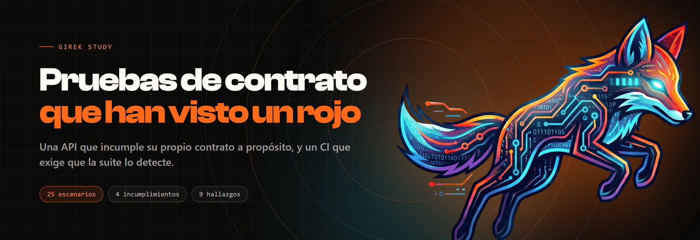

<p>
  
  
  
  
  
</p>

Pruebas de **contrato** con Karate: 25 escenarios que comprueban que una API sea la que su
OpenAPI dijo que era. Trae su propia API de ejemplo, que **incumple ese contrato en cuatro
puntos a propósito**, y un CI que exige que la suite los detecte todos.

No hace falta instalar Java ni Maven: el repositorio trae su propio contenedor.

```bash
git clone https://github.com/Girek-Study/karate-api-contract.git
cd karate-api-contract

docker compose run --rm karate                   # API con los 4 incumplimientos
API_CONFORME=1 docker compose run --rm karate    # API conforme al contrato
```

```
[ERROR] contrato/citas-coleccion.[3:37] El total es el de la colección, no el de la página
[ERROR] contrato/citas-detalle.[1:12]   El detalle de una cita cumple el esquema de Cita
[ERROR] contrato/citas-detalle.[2:24]   El detalle devuelve el mismo objeto que la colección
[ERROR] contrato/citas-creacion.[2:29]  Sin token no se crea nada
[ERROR]   status code was: 201, expected: 401, url: http://api:8090/citas
[ERROR] Tests run: 25, Failures: 4, Errors: 0, Skipped: 0
[INFO] BUILD FAILURE
```

Y con la API conforme, la misma suite sin tocar una línea:

```
[INFO] Tests run: 25, Failures: 0, Errors: 0, Skipped: 0
[INFO] BUILD SUCCESS
```

**Ese `BUILD FAILURE` es el resultado bueno.** Es la mitad que casi ninguna suite tiene.

---

## La pregunta que casi nadie le hace a su suite

No es «¿pasa?». Es:

> **¿Esta suite habría sido capaz de detectar el problema que dice que no existe?**

Aquí esa pregunta tiene respuesta medida, y se mide en cada push. El CI corre la suite dos
veces, contra la misma API en dos modos:

| Trabajo | API | Exige | Qué demuestra |
| --- | --- | --- | --- |
| **`detecta`** | con los 4 incumplimientos | que **falle**, con **4 fallos exactos** | que la suite sirve para algo |
| **`no-miente`** | conforme al contrato | que **pase entera** | que no inventa defectos |
| `contrato` | — | que el OpenAPI pase Spectral | que el oráculo no sea ambiguo |

El segundo trabajo lo tiene todo el mundo. **El primero es el que falta en casi todos los
repositorios de pruebas que he leído**, y sin él no hay ninguna evidencia de que la suite
funcione: una suite vacía y una suite completa dan el mismo verde.

Y no vale con exigir rojo, hay que **contar los fallos**:

```bash
if [ "$FALLOS" != "4" ]; then
  echo "::error::Se esperaban 4 escenarios en rojo y hubo $FALLOS."
  exit 1
fi
```

Tres fallos significa que alguien debilitó una aserción. Cinco, que hay un defecto nuevo que
nadie ha mirado. Las dos cosas merecen un CI rojo, y un `exit 1` a secas no distingue ninguna.

## Antes del código: el trabajo de calidad

Un repositorio de pruebas de API enseña cómo se manda una petición. No enseña **contra qué**
se comprueba ni qué se quedó sin comprobar. Eso está en **[`docs/`](docs/)**:

| | |
| --- | --- |
| [Análisis del contrato](docs/01-analisis-de-contrato.md) | Las cuatro promesas que se rompen sin cambiar ningún código de estado, y lo que el contrato **no** promete |
| [Diseño de casos](docs/02-diseno-de-casos.md) | Los 25 casos, las cuatro técnicas, y los tres que no se pueden escribir mirando un endpoint cada vez |
| [Matriz de trazabilidad](docs/03-matriz-trazabilidad.md) | 44 promesas, 40 con caso — y las **4 sin ninguno**, con su motivo |
| [Análisis de riesgos](docs/04-analisis-riesgos.md) | Seis riesgos, **dos abiertos** |
| [Hallazgos](docs/05-hallazgos.md) | **Nueve.** Cuatro los puse yo a propósito. Cinco no |

Esa última fila es la fila honesta. De los cinco que no puse yo, **cuatro producían verde**:
un `BUILD SUCCESS` con cero escenarios ejecutados, una cita que se borraba sola al anular
otra, una suite que pasaba la primera corrida y fallaba la segunda, y un `200 OK` que venía
del Adminer de otro proyecto. Están corregidos y cada uno dice con qué.

## Los cuatro incumplimientos

Todos responden con un **código de éxito**. Ninguno se ve en el camino feliz.

### 1 y 2 · El detalle cambia el tipo de dos campos

La misma cita, pedida por los dos endpoints, en la misma corrida:

```jsonc
// GET /citas          → datos[0]
{"id":"CITA-0001", "creadoEn":"2026-11-02T04:39:25.203Z", "pacienteId":"PAC-0001", ...}

// GET /citas/CITA-0001
{"id":"CITA-0001", "creadoEn":1793594365203,              "pacienteId":1,          ...}
```

Las dos son 200. Las dos traen los seis campos. `'#present'` pasa, `!= null` pasa. El cliente
que concatene el identificador pedirá `/pacientes/1`, recibirá un 404 en producción tres
semanas después, y nadie lo relacionará con este cambio.

### 3 · `total` cuenta la página, no la colección

```
GET /citas            → total=3  datos=3
GET /citas?limite=1   → total=1  datos=1     ← debería decir total=3
```

Un entero siempre es un entero válido: ningún esquema ve esto. Lo que está mal es **qué cuenta
el número**. El cliente pide la primera página, le cuadra con `total`, y deja de pedir: se
queda con una cita de tres creyendo que vio la agenda entera.

### 4 · `POST /citas` crea sin token

```http
POST /citas            (sin cabecera Authorization)
→ 201  {"id":"CITA-0004","pacienteId":"PAC-0043", ...}
```

Cualquiera escribe en la agenda sin credenciales, y el código de éxito es el mismo que el del
caso bueno. Es el más grave de los cuatro y el que menos se nota: **una suite de camino feliz
lo tiene cien por cien verde**.

## Los tres casos que importan

De los 25, hay tres que no se pueden escribir mirando un endpoint cada vez. Son los que
comparan **dos respuestas entre sí**, sin un solo número mágico:

```gherkin
# CP-13 — el contrato promete que el detalle devuelve el MISMO objeto que la colección
* def deLaColeccion = response.datos[0]
Given path 'citas', deLaColeccion.id
When method get
And match response == deLaColeccion
```

Tres líneas, cero esquemas, y caza cualquier divergencia futura entre los dos endpoints
—incluidas las que no se me han ocurrido—.

```gherkin
# CP-10 — ¿`total` sigue siendo el total cuando pido una sola cita?
* def totalSinPaginar = response.total
* assert cuantasHay > 1       # precondición: con una cita el caso no PUEDE fallar
...
And param limite = 1
And match response.total == totalSinPaginar
```

Ese `assert` es la mitad del caso. Un escenario que pasa cuando no puede fallar no informa de
nada.

El tercero es **CP-25**, y no nació del contrato: nació de un defecto de verdad en la API de
ejemplo. El identificador se calculaba con `citas.size + 1`, así que anular una cita liberaba
su id y la creación siguiente **sobreescribía la cita de otro paciente respondiendo 201**:

```
3 citas → DELETE CITA-0002 → POST → 201 con id CITA-0003 → quedan 2 citas
```

La cita de `PAC-0003` desaparecía. **La suite de 24 escenarios no lo detectaba**, porque ningún
endpoint lo delata por separado: hay que crear, anular y volver a crear en ese orden. Está
corregido y contado en [`docs/05-hallazgos.md`](docs/05-hallazgos.md#h-01).

## El contrato es el oráculo, y se revisa como código

```bash
npm run contrato:lint     # Spectral sobre demo/openapi.yaml
```

Las aserciones no comprueban lo que la API hace: comprueban lo que
[`demo/openapi.yaml`](demo/openapi.yaml) promete. Y eso tiene una consecuencia incómoda:
**cuando la respuesta y el contrato discrepan, el que está mal no es automáticamente el
código**. Un equipo que da por sentado que el código manda no tiene pruebas de contrato, tiene
pruebas de regresión con otro nombre.

Por eso el YAML pasa por Spectral en el CI, con cuatro reglas del conjunto oficial subidas a
`error`: sin descripción, sin `operationId` ni sin etiquetas no se admite un endpoint. **Lo
que el linter no obliga a escribir, las aserciones lo tienen que adivinar**, y ahí ya no se
ve.

Resultado actual: **ni un error ni un aviso**.

## Cuatro trampas de Karate que ya están resueltas aquí

Las cuatro cuestan una corrida y ninguna avisa.

**1. La versión de JUnit no se elige: se copia.** Karate 1.5.1 arrastra
`junit-jupiter-api:5.10.2`. Declarar el motor en 5.11.4 deja dos versiones de JUnit Platform
conviviendo, y el síntoma es `failed to discover tests` con `Tests run: 0`. La versión sale de
`mvn dependency:tree`, no del changelog.

**2. `header` dura UNA petición.** `configure headers` dura el escenario. Los escenarios que
piden dos veces mandan la segunda sin token y reciben un 401 **que parece de la API**.

```gherkin
* configure headers = { Authorization: '#(autorizacion)' }
* configure headers = null        # para quitarla: un `header ... = null` NO la pisa
```

**3. `path` se vacía después de cada `method`.** Un `path` en el `Background` solo vale para la
primera petición. La segunda sale contra la raíz y recibe un 404 que tampoco es de la API.

**4. Sin `<testResources>` explícito, Maven no copia los `.feature`.** `Karate.run` no
encuentra nada, Maven imprime `Tests run: 0` y **el build sale en verde**.

Las cuatro están en [`docs/05-hallazgos.md`](docs/05-hallazgos.md), con el diagnóstico y lo
que las tapa.

## Cómo se organiza

```
demo/
  openapi.yaml            el contrato. El oráculo de todo lo demás
  servidor.js             la API de ejemplo. Node, sin dependencias, 4 incumplimientos
src/test/
  java/.../CorredorTest.java      un @Karate.Test por recurso. Secuencial a propósito
  resources/karate-config.js      los esquemas, una sola vez, y el instante por corrida
  resources/contrato/*.feature    25 escenarios en 6 archivos, uno por recurso
docs/                     el trabajo de calidad: 5 documentos
spectral.yaml             las reglas con las que se revisa el contrato
docker-compose.yml        la API y Maven 3.9 con Java 17, sin instalar nada
```

**La suite es secuencial a propósito.** La API guarda estado en memoria y los escenarios crean
y anulan: dos features en paralelo se pisan, y CP-10 compara dos respuestas entre sí. Una
suite que falla a veces se acaba volviendo a correr hasta que pase, y a partir de ahí ya no
informa de nada. Lo que se ahorraría paralelizando son segundos.

## Correrlo sin Docker

Si ya tienes Java 17 y Maven:

```bash
npm run api                      # la API de ejemplo, en otra terminal
npm run api:conforme             # o la versión conforme al contrato
mvn test -Dapi.url=http://localhost:8090
```

El puerto es el **8090** y no el 8080 a propósito: el 8080 es el puerto más ocupado de
cualquier equipo de desarrollo, y la primera tanda de comprobaciones de este repositorio fue
contra un Adminer de otro proyecto que respondía 200 con HTML.

## Credenciales y datos

| Usuario | Clave | Rol |
| --- | --- | :-: |
| `agenda.gestion` | `gestion-2026` | `GESTOR` |
| `agenda.lectura` | `lectura-2026` | `LECTOR` |

Son de la API de ejemplo, que vive dentro del repositorio y no sale a internet.

Los identificadores de paciente son **correlativos sintéticos** (`PAC-0001`), no documentos de
identidad, para que no haya forma de que una copia de este archivo acabe pareciendo un volcado
de producción.

## Los otros repositorios de esta serie

| | |
| --- | --- |
| [`screenplay-web-bdd`](https://github.com/Girek-Study/screenplay-web-bdd) | Web con Screenplay, Cucumber y Playwright |
| [`screenplay-mobile-bdd`](https://github.com/Girek-Study/screenplay-mobile-bdd) | Móvil con Appium y WebdriverIO |
| [`k6-performance-suite`](https://github.com/Girek-Study/k6-performance-suite) | Carga con k6, dos informes por corrida |

## Licencia

MIT. Ver [LICENSE](LICENSE).

---

[girek-study.com](https://girek-study.com)
